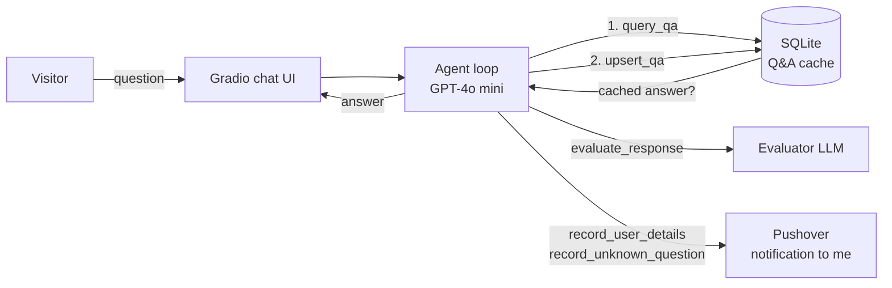

# Career Agent Chatbot

An LLM agent that represents me on the web. Visitors can ask about my background, skills and experience, and the agent answers in my voice, caches its answers, checks its own quality, and notifies me when someone wants to get in touch.

Built with Python, the OpenAI API (GPT-4o mini) with function calling, SQLite and Gradio.

## How it works

The agent runs a tool-calling loop: the model decides which tools to call, the app executes them, sends the results back, and repeats until the model produces a final answer.



### Tools

| Tool | What it does |
|---|---|
| `query_qa` | Looks up the question in a SQLite cache. If a stored answer exists, the agent returns it directly. |
| `upsert_qa` | Stores a newly generated answer so the same question is answered consistently next time. |
| `evaluate_response` | Uses a second LLM call to score an answer from 1 to 5 and give a one-sentence critique. |
| `record_user_details` | Records a visitor's email and context when they want to get in touch, and pushes a notification to my phone. |
| `record_unknown_question` | Logs questions the agent could not answer, so I can fill gaps in its knowledge. |

Questions are normalized before caching (lowercase, collapsed whitespace, trailing punctuation removed), so "What is your favorite color ?" and "what is your favorite color" share one cache entry.

## Run it locally

```bash
git clone https://github.com/youngjulesverne/career-agent-chatbot.git
cd career-agent-chatbot
pip install -r requirements.txt
cp .env.example .env     # then add your OpenAI API key
python app.py
```

Pushover credentials are optional. Without them, notifications are printed to the console instead.

The agent's knowledge comes from `me/summary.txt`. You can also drop a LinkedIn profile export into `me/linkedin.pdf` (ignored by Git) and it will be added to the context automatically.

## Tests

```bash
pytest
```

The tests cover the Q&A cache (insert, update, lookup, question normalization) and the handling of unknown tool calls.

## Project structure

```
app.py            agent, tools and Gradio app
test_qa.py        unit tests
me/summary.txt    background the agent answers from
.env.example      environment variables
requirements.txt  dependencies
```

## Acknowledgements

This project started from the "career conversations" exercise in Ed Donner's Agentic AI Engineering course, which provided the base agent loop and the two notification tools. I extended it with the SQLite Q&A cache and its normalization, the LLM evaluator tool, the step-by-step tool-use protocol in the system prompt, and the tests.

## Author

**Rafael Hasanov**, M.Sc. Data Science student at FAU Erlangen-Nürnberg
